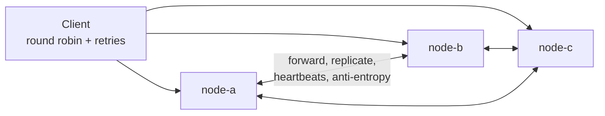

# Self-Healing Distributed Cache

[](https://github.com/suhanipaliwal8/self-healing-cache/actions/workflows/ci.yml)

A Redis-cluster-style cache written in **plain Node.js with no dependencies**. It spreads keys
over several nodes with consistent hashing, keeps two copies of every key, notices when a node
dies, keeps serving from the other copy, and refills the node when it comes back. A built-in
**chaos demo** kills a node under load and checks that nothing was lost.

Built phase by phase as a learning project. Every phase is a pull request with its own tests.

## Features

- [x] HTTP API: `GET`, `PUT`, `DELETE`, with TTL (lazy and active expiry)
- [x] Consistent hashing with virtual nodes
- [x] Any node accepts any request and forwards it to the key's owner
- [x] Replication (factor 2 by default), sync or async
- [x] Heartbeat failure detection
- [x] Automatic failover for reads and writes
- [x] Versions (last write wins) and tombstones, so deletes do not come back
- [x] Rebalancing: nodes can join, leave, or come back empty; copies are repaired by anti-entropy
- [x] A client with round robin and retries
- [x] Graceful shutdown, Docker, Docker Compose, Kubernetes (StatefulSet)
- [x] Chaos demo: kill a node under load and verify every key
- [x] Stretch: LRU eviction
- [x] Stretch: quorum reads and writes (tunable consistency)

## Quick start

Needs Node.js 24 or newer. There is nothing to install.

```bash
npm test                      # 183 tests, built-in test runner

npm start                     # one node on http://localhost:3000
curl -X PUT localhost:3000/keys/hello -H "Content-Type: application/json" -d '{"value":"world","ttl":60}'
curl localhost:3000/keys/hello

npm run cluster               # 3 nodes on ports 3001, 3002, 3003 (type "kill node-c" to crash one)
```

On Windows PowerShell use `curl.exe` instead of `curl`.

## The demo: kill a node under load

```bash
docker compose up -d --build
npm run chaos -- --kill "docker compose stop node-c" --duration 30 --kill-at 10 --retries 2
```

Four workers write a key and read it back. At 10 seconds a node is stopped. Afterwards every key
that was written is read back and compared. The result shows failed requests, wrong values, lost
keys and latency percentiles, and ends with `PASS` or `FAIL`.

A request that is already on its way to the dying node needs a retry, so use at least as many
retries as there are nodes minus one (`--retries 2` for 3 nodes). The same demo runs in CI on
Docker Compose and on a `kind` Kubernetes cluster. More demos: [docs/DEMO.md](docs/DEMO.md).

## How it works



- Keys sit on a **hash ring**. A key's owners are the next 2 nodes on the ring (primary and replica).
- A write goes to the primary, which stores it with a **version** and copies it to the replica.
- If the primary is unreachable, the replica takes over (**failover**). Reads fall back the same way.
- Nodes **ping each other**. Three missed pings mark a node down; one good ping marks it up.
- A node that returns is **refilled** by its peers, and keys move by themselves when nodes join or leave.

Full explanation with sequence diagrams: [docs/ARCHITECTURE.md](docs/ARCHITECTURE.md).

## API

| Method | Path | What it does |
|---|---|---|
| `GET` | `/keys/:key` | Returns `{ "key", "value", "expiresAt"? }`, or `404` |
| `PUT` | `/keys/:key` | Body `{ "value": <any JSON>, "ttl": <seconds, optional> }` |
| `DELETE` | `/keys/:key` | Returns `{ "deleted": true or false }` |
| `GET` | `/health` | `{ "status": "ok" }` |
| `GET` | `/cluster` | This node's id and its view of the members (up or down) |
| `GET` | `/stats` | This node's `{ keys, maxEntries, evictions }` |
| `PUT` | `/cluster/nodes/:id` | Add a node. Body `{ "url": "http://host:port" }` |
| `DELETE` | `/cluster/nodes/:id` | Remove a node (it hands its keys over first) |

Other statuses: `400` bad request, `502` every owner of the key is unreachable, `503` a quorum
was not reached. Responses carry `x-served-by`; replicated writes carry `x-replicated-to`; a
write served by a replica carries `x-failed-over-from`.

## Configuration (environment variables)

| Variable | Default | Meaning |
|---|---|---|
| `NODE_ID` | `node-1` | This node's name (must appear in `CLUSTER`) |
| `PORT` | from the node's own URL, or `3000` | Port to listen on |
| `CLUSTER` | empty (single node) | Members as `id=url` pairs, for example `node-a=http://localhost:3001,node-b=http://localhost:3002` |
| `REPLICATION_FACTOR` | `2` | Copies of each key (N) |
| `REPLICATION_MODE` | `sync` | `sync` waits for the replicas, `async` does not |
| `WRITE_QUORUM` | `1` | Acks needed for a write (1 to N). Above 1 needs `sync` |
| `READ_QUORUM` | `1` | Answers used for a read (1 to N). The newest version wins |
| `MAX_ENTRIES` | `0` (no limit) | Most live keys per node. When full, the least recently used key is evicted |
| `HEARTBEAT_INTERVAL_MS` | `1000` | How often to ping every peer |
| `HEARTBEAT_TIMEOUT_MS` | `500` | How long to wait for one ping |
| `FAILURE_THRESHOLD` | `3` | Failed pings in a row before a peer is "down" |
| `ANTI_ENTROPY_INTERVAL_MS` | `5000` | How often a node compares notes with every peer |

## Quorum reads and writes

With N copies, a write needs W acks and a read asks R nodes. **W + R > N** means a read always
sees the latest successful write. Defaults are W=1 and R=1 (fast, may be stale).

```bash
docker compose -f docker-compose.yml -f docker-compose.quorum.yml up -d --build   # N=3, W=2, R=2
```

With one node down everything still works. With two down, a write or read answers `503` instead
of risking an old value: consistency over availability (the "C" in CAP). Too few acks never roll
back the copy that was already written (see limitations).

## Memory limit and LRU eviction

`MAX_ENTRIES=N` limits one node to N live keys. When a new key does not fit, the **least recently
used** key goes. A JavaScript `Map` remembers insertion order, so this costs O(1): the first key is
the oldest, and using a key moves it to the end. Tombstones are not counted and never evicted.
Background copying never evicts: a full node refuses new keys from anti-entropy, because otherwise
eviction and anti-entropy would undo each other forever.

## Docker and Kubernetes

```bash
docker compose up -d --build        # 3 nodes on ports 3001, 3002, 3003
docker compose down
```

```bash
kind create cluster --name cache
docker build -t self-healing-cache:dev .
kind load docker-image self-healing-cache:dev --name cache
kubectl apply -f k8s/               # StatefulSet, headless Service, client Service, PodDisruptionBudget
kubectl rollout status statefulset/cache
npm run k8s:forward                 # pods on localhost:3001..3003
```

The image uses `node:24-alpine`, runs as a non-root user, has a health check, and starts node
directly so SIGTERM reaches it and shutdown is graceful.

## npm scripts

| Script | What it does |
|---|---|
| `npm start` | One node (or a cluster member, if `CLUSTER` is set) |
| `npm run cluster` | 3 local nodes with an interactive prompt (`status`, `kill`, `start`, `freeze`, `thaw`, `join`, `leave`) |
| `npm run chaos` | The chaos demo (see above) |
| `npm run demo:data` | `fill`, `check` and `where` for data placement |
| `npm run demo:client` | A client loop to watch while you kill nodes |
| `npm run demo:ring` | How the hash ring spreads keys |
| `npm run k8s:forward` | Reach the Kubernetes pods from your laptop |
| `npm test` | All tests |

## Tests

183 tests with the built-in `node:test` runner. Cluster tests start real in-process nodes on free
ports; time-based tests use a fake clock.

| Phase | New tests | Total |
|---|---|---|
| 0 Setup and CI | 1 | 1 |
| 1 Single cache node | 11 | 12 |
| 2 TTL expiry | 12 | 24 |
| 3 Consistent hash ring | 11 | 35 |
| 4 Cluster and routing | 18 | 53 |
| 5 Replication | 17 | 70 |
| 6 Heartbeat failure detection | 20 | 90 |
| 7 Write failover and client retry | 16 | 105 |
| 8 Versions, rebalancing, join and leave | 26 | 131 |
| 9 Docker | 6 | 137 |
| 10 Kubernetes | 3 | 140 |
| 11 Chaos demo | 11 | 151 |
| 12 LRU eviction | 16 | 167 |
| 13 Quorum reads and writes | 16 | 183 |

CI runs the tests, then starts the Compose cluster and runs the chaos demo, and also runs the
chaos demo on a `kind` Kubernetes cluster.

## Project structure

```
src/
  hash-ring.js        consistent hash ring
  cluster.js          members, up/down state, key owners
  store.js            memory: versions, tombstones, TTL, LRU
  server.js           HTTP API, routing, replication, failover, quorum
  failure-detector.js heartbeats
  rebalancer.js       anti-entropy and key movement
  expiry.js           active expiry sweeper
  client.js           CacheClient (round robin, retries)
  quorum.js           firstSuccesses and newestRecord
  config.js           environment variables
  shutdown.js         graceful shutdown
  chaos.js            load generator and verifier
  index.js            wiring
scripts/              dev-cluster, chaos-demo, data-demo, client-demo, ring-demo, k8s-forward
k8s/                  statefulset.yaml, services.yaml, pdb.yaml
docs/                 ARCHITECTURE.md, DEMO.md
test/                 all tests
Dockerfile
docker-compose.yml
docker-compose.quorum.yml
```

## Known limitations

| Limitation | Why it matters |
|---|---|
| Data lives in memory only | If every node restarts at once, the cache is empty. That is normal for a cache. |
| The limit counts keys, not bytes | A few huge values can still use a lot of memory. |
| Evicted keys are gone | Eviction is per node; the other copy and read on miss usually still serve the key. |
| Full peers keep refusing repair | A full node refuses new keys from anti-entropy, so peers may re-send them every round (some wasted traffic, no data loss). |
| A failed quorum write is not rolled back | A `503` means "not confirmed"; one node may still hold the value and anti-entropy can spread it. |
| Not linearizable | Versions are timestamps, so clocks that disagree can make "newest" wrong by milliseconds. |
| No auth or TLS | Run it on a private network. |
| A request in flight when a node dies | It can fail once. Use enough retries (N - 1) in the client. |

## Ideas for later

LFU eviction, a byte-size limit, hinted handoff, sloppy quorums, gossip-based membership,
persistence (snapshots or an append-only log).

## License

MIT