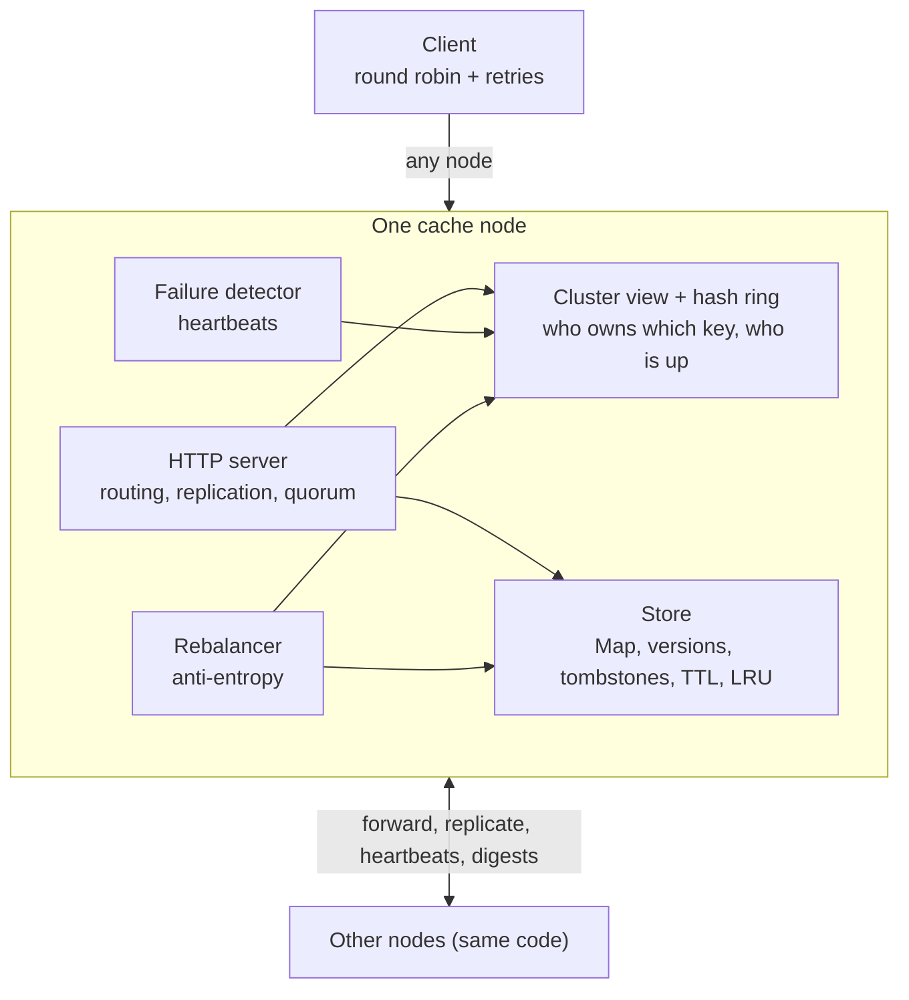
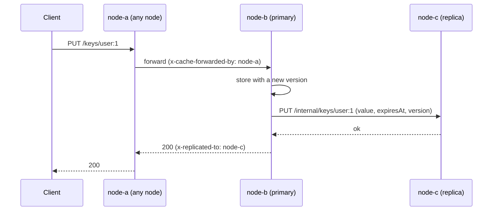
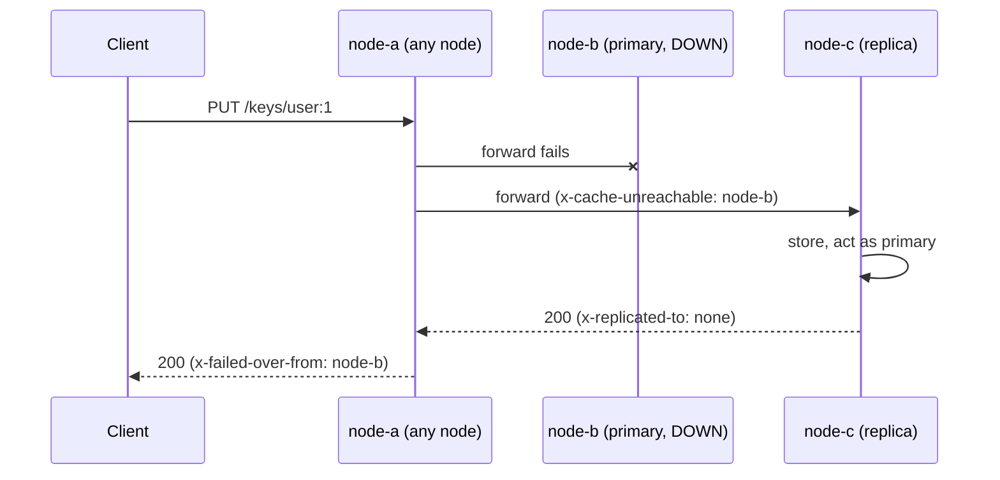
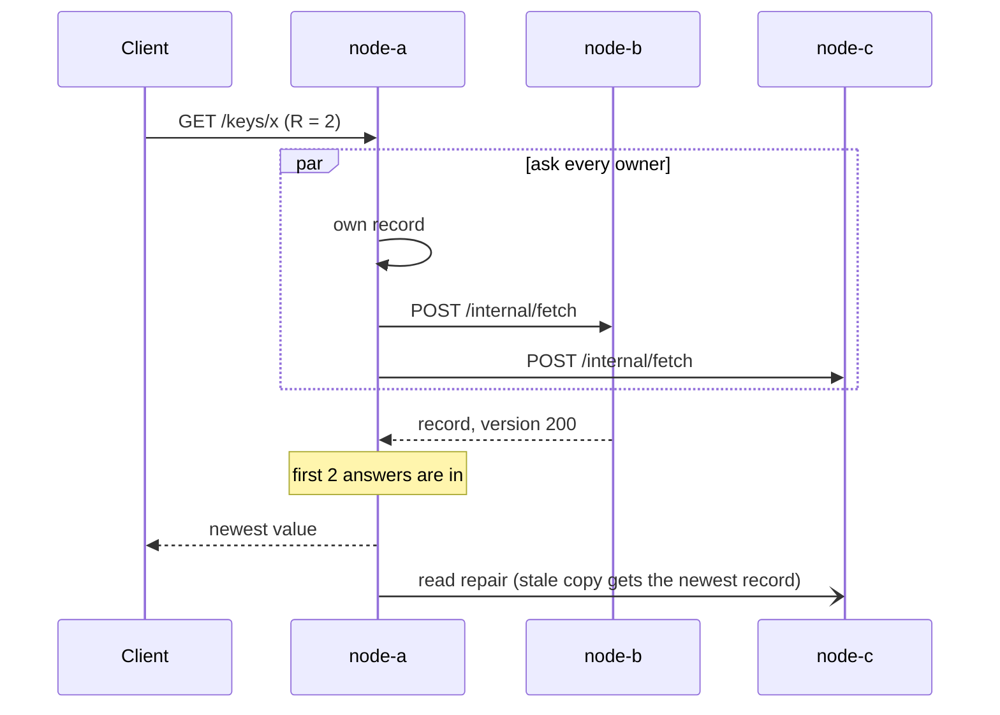

# Architecture

This document explains how the cache works inside. For how to run it, see the
[README](../README.md); for step-by-step demos, see [DEMO.md](DEMO.md).

## 1. Overview

Every node runs the **same program**. There is no leader and no separate "router". A client
can send any request to any node. That node finds the key's owners on a hash ring and sends
the request on.

## 2. Modules

| File | Job |
|---|---|
| `src/hash-ring.js` | Consistent hash ring: MD5 cut to 32 bits, 100 virtual nodes per node, binary search. `getNodes(key, n)` returns n distinct owners, clockwise. |
| `src/cluster.js` | Who is in the cluster (id and URL), who is up or down, and `ownersOf(key, n)`. |
| `src/store.js` | The memory of one node: values, absolute expiry, versions, tombstones, LRU order. |
| `src/server.js` | HTTP API, forwarding, replication, failover, read repair, quorum. |
| `src/failure-detector.js` | Pings every peer's `/health`; marks a peer down after 3 misses in a row. |
| `src/rebalancer.js` | Keeps copies correct: moves keys on join or leave, refills a node that came back empty. |
| `src/expiry.js` | Active expiry: a timer that sweeps expired keys every second. |
| `src/client.js` | `CacheClient`: round robin over nodes, retries on another node. |
| `src/quorum.js` | `firstSuccesses` (wait for N of M answers) and `newestRecord`. |
| `src/config.js` | Reads and validates environment variables. |
| `src/shutdown.js` | Graceful shutdown on SIGTERM and SIGINT. |
| `src/chaos.js` | Load generator and verifier behind `npm run chaos`. |
| `src/index.js` | Wires everything together from the environment. |

## 3. Data model

Every key is stored as a **record**:

| Field | Meaning |
|---|---|
| `value` | Any JSON value. |
| `expiresAt` | Absolute time in ms since 1970, or `null`. Copies get the same absolute time, so a key dies at the same moment everywhere. |
| `version` | Time of the write (ms), always rising on one node. The newest version wins ("last write wins"). |
| `writer` | The node that wrote it. Breaks a tie when two versions are equal, so every node picks the same winner. |
| `deleted` | `true` for a **tombstone**. |

A delete does not forget the key. It leaves a tombstone (kept 10 minutes). Without it, a node
that missed the delete would later hand the old value back to everyone ("resurrection").

## 4. Request flow

### Write (default: replication factor 2, sync)

- A forwarded request is always handled where it lands. The `x-cache-forwarded-by` header is
  the **loop guard**, so nodes can never bounce a request around forever.
- Replicas receive the absolute expiry time and the version, and keep a record only if it is newer.
- A replica that is believed down is not waited for. It still gets the change in the background.
- `REPLICATION_MODE=async` answers without waiting for the replicas.

### Write when the primary is down (failover)

Owners are tried **up nodes first**; nodes the detector thinks are down go last. A wrong guess
by the detector therefore never causes an outage. `x-cache-unreachable` tells the next node
which owners already failed, so it does not waste a whole timeout on them.

### Read

The node asks the owners in order (up nodes first). If the primary is unreachable **or does
not have the key** (for example it just restarted empty), the replicas are asked too. Only
when nobody has it is the answer `404`.

## 5. Failure detection and healing

- Every node pings every peer's `/health` each second (500 ms timeout).
- **3 failed pings in a row** mark a peer down. One good ping marks it up again.
- When a peer comes back up, the node starts a **reconcile** round to catch it up.

**Rebalancer (`reconcile`)** runs at start-up, when a peer comes back, after a join or leave,
and every `ANTI_ENTROPY_INTERVAL_MS`. For each peer it:

1. fetches a **digest** (`GET /internal/digest`): every key with its version, no values;
2. **pushes** records the peer lacks or has older (`POST /internal/entries`);
3. **pulls** records it should hold but lacks (`POST /internal/fetch`);
4. forgets a key it no longer owns only after **all** new owners confirmed it.

Running a round twice changes nothing the second time, so it is always safe to repeat.

**Membership** changes at run time with `PUT /cluster/nodes/:id` (join) and
`DELETE /cluster/nodes/:id` (leave). Keys move by themselves.

## 6. Quorum reads and writes

Optional (`WRITE_QUORUM`, `READ_QUORUM`, default 1 and 1). With N copies, W write acks and
R read answers, **W + R > N** means every read sees at least one copy of the latest successful write.

- **Write:** the node's own copy is ack 1; the others are asked at the same time; the answer
  goes out at W acks. Too few: `503` with `{ needed, got }`.
- **Read:** the first R answers decide; the newest version wins; a newest tombstone means `404`.
- A failed quorum write is **not rolled back** (see limits).

## 7. TTL, tombstones and LRU

- **TTL:** lazy (an expired key disappears when asked for) and active (a sweeper each second).
- **LRU (`MAX_ENTRIES`):** a JavaScript `Map` remembers insertion order, so the first key is the
  least recently used. Using a key moves it to the end. Tombstones are neither counted nor evicted.
- Background copying uses `evict: false`: a full node **refuses new keys** from anti-entropy
  instead of evicting. Otherwise eviction and anti-entropy would undo each other forever.
  Normal client writes do evict.

## 8. Deployment

| Where | How |
|---|---|
| Local | `npm run cluster` starts 3 to 5 processes on ports 3001 and up. |
| Docker | `docker-compose.yml`: three containers, nodes find each other by service name. `docker-compose.quorum.yml` turns on quorum. |
| Kubernetes | A **StatefulSet** (`cache-0..2`, stable names) behind a **headless Service** (DNS names like `cache-0.cache`), a normal `cache-client` Service, a PodDisruptionBudget (`maxUnavailable: 1`), readiness and liveness probes. |

Notes that cost real debugging time:

- `CMD ["node", "src/index.js"]` (not `npm start`), so SIGTERM reaches node and shutdown is clean.
- The container runs as the non-root `node` user; Kubernetes needs the numeric `runAsUser: 1000`.
- Node resolves host names in a **thread pool of 4**. A stopped container's name can take seconds
  to fail, and a few stuck lookups would freeze calls to healthy nodes too. The Dockerfile sets
  `UV_THREADPOOL_SIZE=64` and compose sets `dns_opt: timeout:1, attempts:1`.

## 9. What the cache guarantees

| Setting | Behaviour |
|---|---|
| W=1, R=1 (default) | Available and fast. After a failure or a partition a read may return an older value. Copies converge through anti-entropy. |
| W + R > N (for example N=3, W=2, R=2) | A read sees the latest **successful** write. A minority side answers `503` instead of a possibly old value. |

| Failure | What happens |
|---|---|
| One node crashes | Requests that hit it fail over to the next owner (a request can wait up to the 2 s forward timeout until the detector marks it down). No data is lost while another copy lives. |
| A node restarts empty | Peers refill it. Reads that reach it are answered by replicas (read on miss). |
| Two nodes crash (N=2) | Keys that lived only on those two are lost. It is a cache. |
| Network partition | Both sides may accept writes (W=1). Versions pick a winner when they reconnect. With quorum, the minority refuses. |
| A node is full (LRU) | It evicts its oldest key; the other copy and read on miss still serve it. |

## 10. Known limits

- Memory only. A full restart of every node empties the cache.
- The limit is a number of **keys**, not bytes.
- "Newest" uses timestamps. Clocks that disagree can make it wrong by milliseconds, so this is not linearizable.
- A failed quorum write is not rolled back; one node may still hold the value.
- Membership is configured (`CLUSTER`) or changed through the API. There is no automatic discovery.
- No authentication or TLS between nodes. Run it on a private network.

## 11. Ideas for later

LFU eviction, a byte-size limit, hinted handoff (keep writes for a down node and replay them),
sloppy quorums, gossip-based membership, persistence (snapshots or an append-only log).